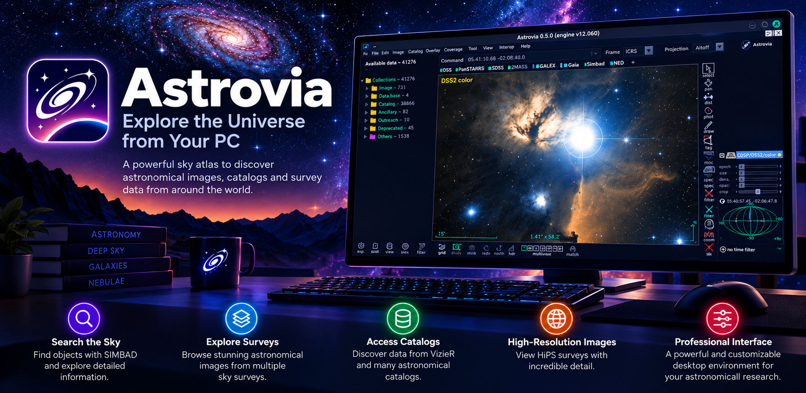
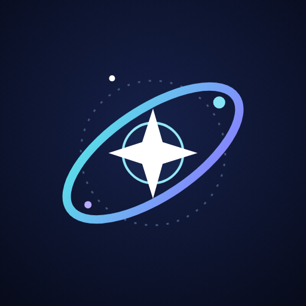

<p align="center">
  
</p>

<h1 align="center">
   Astrovia
</h1>

<p align="center"><b>Open-source sky atlas for Windows, Linux and Android.</b></p>

<p align="center">
  <a href="https://apps.microsoft.com/detail/9pk3fbqlh2x3?cid=DevShareMCLPCS&hl=en-US&gl=ES"></a>
  <a href="https://github.com/kroryan/Astrovia/releases"></a>
  
</p>

Astrovia lets you explore the sky with HiPS surveys, overlay Simbad and VizieR catalogues, and work with
FITS images and MOC coverage, in a modern dark interface. Free, no ads, no tracking.

> **Astrovia is an independent community project based on the [Aladin Sky Atlas](https://aladin.cds.unistra.fr/)**
> developed by the Centre de Données astronomiques de Strasbourg (CDS). It is **not** affiliated with,
> endorsed by or sponsored by the CDS or the Aladin project. "Aladin", "CDS", "Simbad" and "VizieR" belong
> to their respective owners and are only mentioned to credit the original work and data.
> This adaptation was created with the help of artificial intelligence tools and may contain mistakes.

## Editions

| Edition | Where | Notes |
|---|---|---|
| **Desktop** (Linux, Windows) | this repository (`src/`) | Java/Swing, based on Aladin Desktop. See [DESKTOP.md](DESKTOP.md) |
| **Android** | [`Astrovia/`](Astrovia/README.md) | Native Kotlin / Jetpack Compose app |

## Install (desktop)

### Debian / Ubuntu / Linux Mint (apt repository)

Add the Astrovia repository once, then install and update it with `apt`:

```
sudo install -d -m 0755 /etc/apt/keyrings
curl -fsSL https://kroryan.github.io/Astrovia/astrovia.gpg | sudo tee /etc/apt/keyrings/astrovia.gpg >/dev/null
echo "deb [signed-by=/etc/apt/keyrings/astrovia.gpg] https://kroryan.github.io/Astrovia stable main" | sudo tee /etc/apt/sources.list.d/astrovia.list
sudo apt update
sudo apt install astrovia
```

Astrovia then updates with the rest of your system (`sudo apt upgrade`). Requires Java 8 or newer
(`default-jre` is pulled in automatically). To remove it:

```
sudo apt remove astrovia
sudo rm /etc/apt/sources.list.d/astrovia.list /etc/apt/keyrings/astrovia.gpg
```

You can also install the `.deb` directly from the Releases page: `sudo apt install ./astrovia_<version>_all.deb`

### Other options

- **Windows (recommended):** get it from the [Microsoft Store](https://apps.microsoft.com/detail/9pk3fbqlh2x3?cid=DevShareMCLPCS&hl=en-US&gl=ES), or run `Astrovia-<version>-windows-setup.exe` (includes its own Java runtime), or use the portable zip
- **Any OS:** `java -jar Astrovia.jar` (Java 8+)
- **Linux portable:** unpack `astrovia-<version>-linux.tar.gz` and run `./astrovia.sh`

Binaries are published on the [Releases](https://github.com/kroryan/Astrovia/releases) page.
User data lives in `~/.astrovia`.

## Build

```
./package-desktop.sh      # Linux .deb, Windows installer/zip, MSIX, jar  -> release/desktop/
./build-desktop.sh        # only Astrovia.jar
```

Details, Microsoft Store and apt repository instructions: [DESKTOP.md](DESKTOP.md).
Installer exit codes: [docs/installer-return-codes.md](docs/installer-return-codes.md).
The Android build is described in [Astrovia/README.md](Astrovia/README.md).

## Licence and attribution

Astrovia is distributed under the **GNU General Public License v3** ([COPYING](COPYING)), the same licence as
the original software. Copyright of the original Aladin code: © Université de Strasbourg/CNRS (CDS).
Astrovia modifications: kroryan. The program comes with ABSOLUTELY NO WARRANTY.
See [NOTICE.md](NOTICE.md) for modifications and third-party components.

## Data and privacy

Astrovia connects to public astronomical services (HiPS servers, Simbad and VizieR at CDS); coordinates and
names you query are sent to those servers. Astrovia itself collects nothing. See
[Astrovia/PRIVACY.md](Astrovia/PRIVACY.md).

## Contributing

Bug reports and pull requests are welcome on [GitHub](https://github.com/kroryan/Astrovia/issues).
For problems with the original Aladin, contact the CDS directly.
